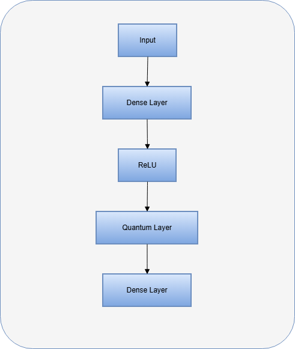
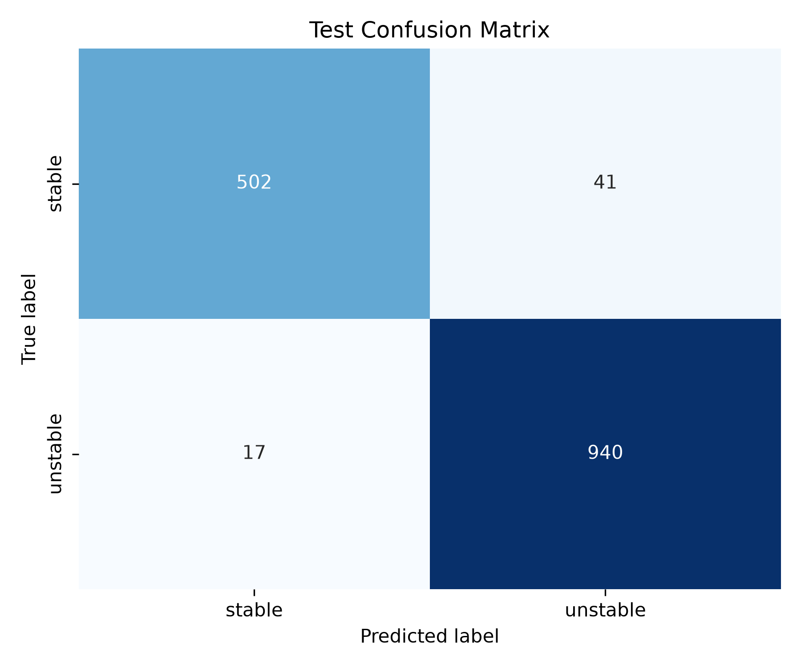
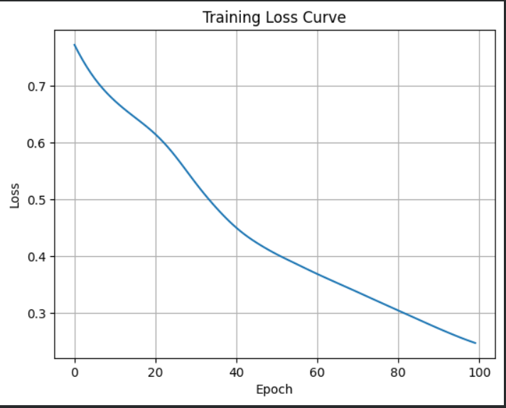
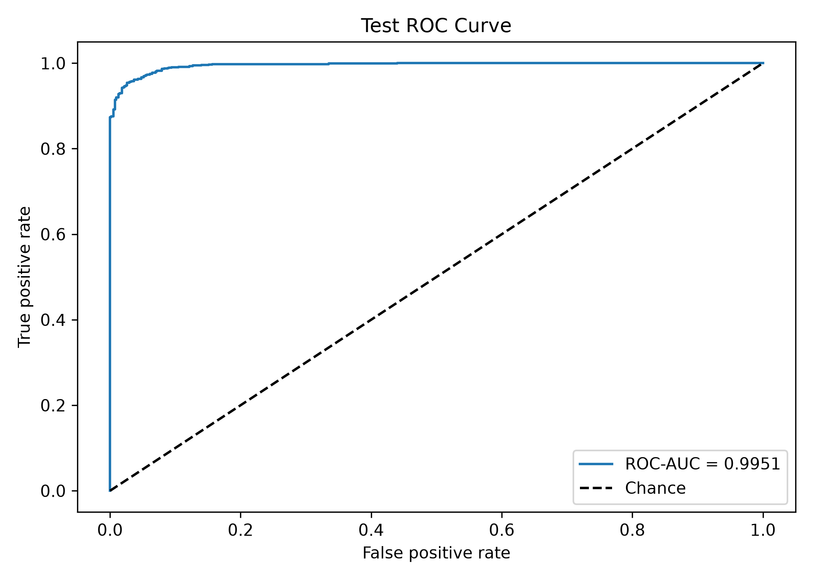

# Quantum-Classical Hybrid Neural Network for Smart Grid Stability Classification

A hybrid quantum-classical machine learning approach for electrical grid stability classification using **PyTorch, PennyLane, and variational quantum circuits**.

[](https://www.python.org/)
[](https://pytorch.org/)
[](https://pennylane.ai/)
[](LICENSE)

---

## 1. Overview

Electrical grid stability is an important challenge in modern power systems. This project investigates the application of a **hybrid quantum-classical neural network** for classifying electrical grid operating conditions as stable or unstable.

The proposed approach integrates classical neural network layers with a parameterized quantum circuit. Its performance is compared against two classical machine learning algorithms:

- Random Forest
- XGBoost

The study evaluates predictive performance, variability across random seeds, and computational training cost.

**Research objective:** Investigate the effectiveness and practical computational trade-offs of a quantum-classical hybrid architecture for grid stability classification.

## 2. Dataset

**Dataset:** [Electrical Grid Stability Simulated Dataset — UCI Machine Learning Repository](https://archive.ics.uci.edu/dataset/471/electrical+grid+stability+simulated+data)

Dataset characteristics:

- 10,000 observations
- 12 predictive features
- Binary classification target: `stabf`
- Classes: Stable and Unstable

### Data preprocessing

The following preprocessing procedures are implemented:

1. Remove the continuous `stab` column because it is derived from the target label.
2. Separate the predictive features and target.
3. Perform stratified training, validation, and test splitting.
4. Fit the feature scaler only on the training data.
5. Apply the fitted scaler to validation and test data.

| Dataset split | Samples |
|---|---:|
| Training | 7,000 |
| Validation | 1,500 |
| Testing | 1,500 |
| **Total** | **10,000** |

These steps are designed to prevent target leakage and avoid information from the validation or test sets influencing feature scaling.

## 3. Proposed Architecture

The proposed model combines classical neural network layers with a variational quantum circuit.

### Architecture components

1. **Classical feature processing:** Dense layer with nonlinear activation.
2. **Regularization:** Dropout.
3. **Quantum feature encoding:** Angle Embedding.
4. **Variational quantum circuit:** Strongly Entangling Layers.
5. **Quantum measurement:** Pauli-Z expectation values.
6. **Classification:** Classical output layer for binary prediction.

### Quantum circuit configuration

| Parameter | Configuration |
|---|---|
| Quantum framework | PennyLane |
| Quantum simulator | `default.qubit` |
| Number of qubits | 6 |
| Entangling layers | 6 |
| Feature embedding | Angle Embedding |
| Variational ansatz | StronglyEntanglingLayers |
| Measurement | Pauli-Z expectation values |

### Architecture diagram



## 4. Experimental Setup

Three models were evaluated:

| Model | Type |
|---|---|
| Hybrid Quantum-Classical Neural Network | Quantum-classical hybrid |
| Random Forest | Classical ensemble |
| XGBoost | Gradient boosting |

### Reproducibility configuration

Experiments were conducted using five random seeds:

`42, 7, 21, 100, 2026`

The reported metrics represent the mean and sample standard deviation across five experimental runs.

The hybrid model uses validation-loss-based checkpoint selection before final test evaluation.

## 5. Experimental Results

### Five-seed performance comparison

All values are reported as mean ± standard deviation.

| Metric | Hybrid Quantum-Classical | Random Forest | XGBoost |
|---|---:|---:|---:|
| Accuracy | **95.707 ± 0.599%** | 91.733 ± 1.053% | 94.600 ± 0.685% |
| Precision | **96.197 ± 0.772%** | 91.692 ± 0.699% | 94.550 ± 0.488% |
| Recall | 97.116 ± 0.699% | 95.716 ± 1.108% | **97.137 ± 0.876%** |
| F1-score | **96.652 ± 0.465%** | 93.659 ± 0.820% | 95.824 ± 0.538% |
| ROC-AUC | **99.276 ± 0.257%** | 97.832 ± 0.566% | 99.032 ± 0.268% |

### Training time comparison

| Model | Mean training time | Standard deviation |
|---|---:|---:|
| Hybrid Quantum-Classical | 918.14 seconds | 140.98 seconds |
| Random Forest | 1.29 seconds | 0.05 seconds |
| XGBoost | 2.48 seconds | 0.82 seconds |

### Results interpretation

- The hybrid model achieved the highest mean accuracy, precision, F1-score, and ROC-AUC among the evaluated models.
- XGBoost achieved a marginally higher mean recall.
- The hybrid model required substantially more training time than the classical baselines.
- These results demonstrate performance on the selected simulated dataset; they do not establish quantum computational advantage.

### Hybrid model evaluation plots

**Confusion Matrix**



**Training Loss Curve**



**ROC Curve**



## 6. Reproducibility and Experiment Artifacts

The repository contains experiment outputs and aggregated results across five random seeds.

### Reproducibility files

- [Five-seed summary JSON](results/reproducibility/summary/five_seed_summary.json)
- [Mean and standard deviation CSV](results/reproducibility/summary/five_seed_mean_std.csv)
- [All experimental runs CSV](results/reproducibility/summary/five_seed_all_runs.csv)

### Model artifacts

The results directory also contains:

- Trained model checkpoints
- Preprocessing scalers
- Label encoders
- Training histories
- Confusion matrices
- ROC curves
- Feature importance plots

## 7. Technology Stack

| Category | Technologies |
|---|---|
| Programming language | Python |
| Deep learning | PyTorch |
| Quantum machine learning | PennyLane |
| Data processing | NumPy, Pandas |
| Classical machine learning | Scikit-learn, XGBoost |
| Visualization | Matplotlib, Seaborn |
| Model persistence | Joblib, PyTorch |

## 8. Repository Structure

```text
quantum-fault-detection/
│
├── data/
│   └── sg_raw_data.csv
│
├── notebooks/
│   ├── QML_Fault_Detection.ipynb
│   └── QML_Fault_Detection_final.ipynb
│
├── results/
│   ├── architecture.png
│   ├── Confusion_Matrix.png
│   ├── Loss_Curve.png
│   ├── roc_curve.png
│   ├── metrics.json
│   ├── random_forest/
│   ├── xgboost/
│   └── reproducibility/
│       ├── seed_7/
│       ├── seed_21/
│       ├── seed_42/
│       ├── seed_100/
│       ├── seed_2026/
│       └── summary/
│
├── src/
│   ├── aggregate_reproducibility.py
│   ├── dataset.py
│   ├── model.py
│   ├── quantum_layer.py
│   ├── random_forest_baseline.py
│   ├── train.py
│   └── xgboost_baseline.py
│
├── tests/
│   ├── test_pipeline.py
│   └── test_quantum_layer.py
│
├── requirements.txt
├── .gitignore
└── README.md
```

The Python scripts in `src/` are the primary implementation for the reported experiments. The notebooks are retained as experimental documentation.

## 9. Installation and Execution

### Step 1: Clone the repository

```bash
git clone https://github.com/sriram14062007-glitch/quantum-fault-detection.git

cd quantum-fault-detection
```

### Step 2: Install dependencies

```bash
pip install -r requirements.txt
```

### Step 3: Train the hybrid quantum-classical model

```bash
python -m src.train
```

### Step 4: Run classical baselines

Random Forest:

```bash
python -m src.random_forest_baseline
```

XGBoost:

```bash
python -m src.xgboost_baseline
```

### Step 5: Run tests

```bash
python -m unittest discover -s tests -v
```

### Step 6: Aggregate reproducibility results

```bash
python -m src.aggregate_reproducibility
```

## 10. Limitations

- The dataset is simulated and may not represent all real-world grid operating conditions.
- Quantum circuits are evaluated using a classical quantum simulator.
- The hybrid model has substantially higher computational training cost than the classical baselines.
- Five random seeds provide an initial reproducibility assessment, not definitive statistical evidence.
- No quantum advantage or superiority on real quantum hardware is claimed.

## 11. Future Work

Potential directions for further investigation include:

- Evaluating the approach on additional power-system datasets.
- Investigating noise-aware quantum circuit architectures.
- Exploring different qubit counts and circuit depths.
- Performing broader hyperparameter and statistical analyses.
- Evaluating the architecture on available quantum hardware.
- Studying generalization to real-world grid monitoring data.

## 12. License

This project is licensed under the MIT License. See the [LICENSE](LICENSE) file for details.

## 13. Acknowledgements

- [UCI Machine Learning Repository](https://archive.ics.uci.edu/)
- [PennyLane](https://pennylane.ai/)
- [PyTorch](https://pytorch.org/)

---

**Repository:** [Quantum Fault Detection](https://github.com/sriram14062007-glitch/quantum-fault-detection)
